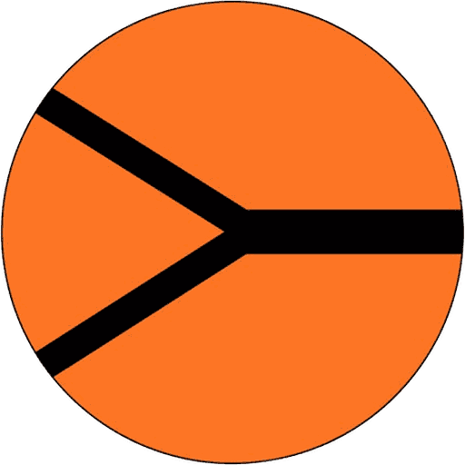
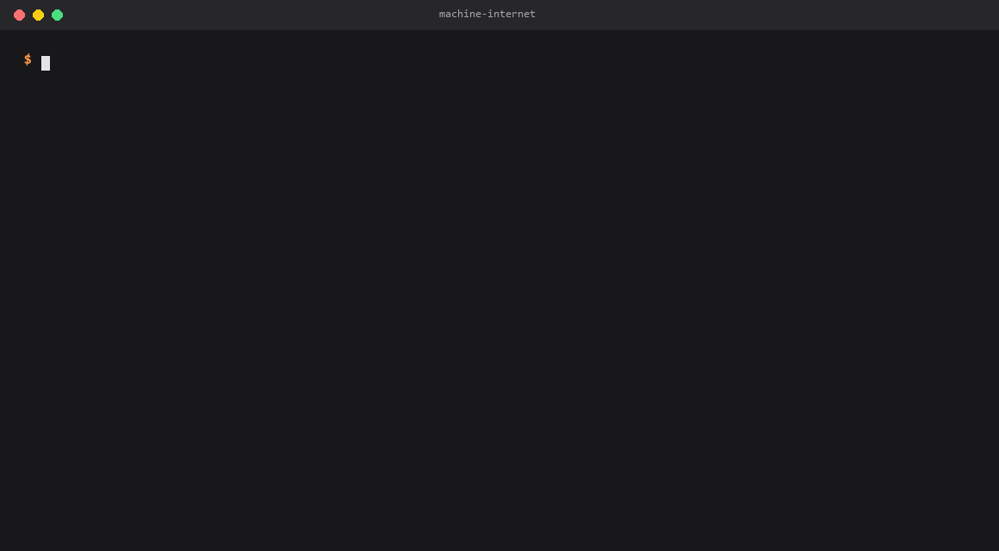

<p align="center"></p>

<h1 align="center">Machine Internet</h1>

**Turn any website into an MCP server. No API needed.**

```bash
uvx machine-internet wrap https://www.ycombinator.com/companies
```

Machine Internet opens the site in a headless browser, watches the hidden API calls the page makes, and turns them into a small set of clean tools that Claude, Cursor or any MCP client can call directly.



**Try it in your browser, nothing to install:** [machine-internet.vercel.app](https://machine-internet.vercel.app) runs every tool below against the real site.

[](https://github.com/chetanty/machine_internet/actions/workflows/ci.yml)


---

## Try it in 30 seconds (no API key)

Eight sites come pre-wrapped. None of them offers a public API for this data. Add one to your Claude Desktop or Cursor config:

```json
{
  "mcpServers": {
    "yc": {
      "command": "uvx",
      "args": ["machine-internet", "serve", "yc_companies"]
    }
  }
}
```

Restart your client and ask: *"Which YC companies from the last two batches are building robotics, and what do they do?"*

| Example | Site | Tools |
|---|---|---|
| `yc_companies` | [YC company directory](https://www.ycombinator.com/companies) | search every YC company by keyword, batch, industry, status, team size |
| `openrouter` | [OpenRouter rankings](https://openrouter.ai/rankings) | 15: top models and apps by real token usage, market share, benchmarks, spend by task, providers |
| `luma` | [Luma events](https://luma.com/discover) | 6: cities, upcoming events in a city, calendars, categories |
| `vscode_marketplace` | [VS Code Marketplace](https://marketplace.visualstudio.com/vscode) | search extensions with install counts and ratings |
| `bundlephobia` | [bundlephobia.com](https://bundlephobia.com) | 6: package size, tree-shaking check, size history, similar packages, per-export sizes |
| `caniuse` | [caniuse.com](https://caniuse.com) | 4: search features, browser support data, feature bugs, notes and links |
| `npm_trends` | [npmtrends.com](https://npmtrends.com) | 4: package info, weekly downloads, download trends, GitHub stats |
| `regex101` | [regex101.com](https://regex101.com) | 3: browse the community library, get a saved regex, list versions |

Each one was made with `wrap`. A few needed small hand fixes afterwards (the VS Code request body, caniuse's form encoding, some parameter defaults); the tables below are honest about what `wrap` gets right on its own.

You need [uv](https://docs.astral.sh/uv/) for `uvx`. Or install it once with `pip install machine-internet` (or straight from GitHub: `pip install git+https://github.com/chetanty/machine_internet`) and use `machine-internet` as the command.

**Hosted, nothing to install:** every example is also live at [machine-internet.vercel.app](https://machine-internet.vercel.app) as a remote MCP endpoint, e.g. `https://machine-internet.vercel.app/mcp/yc_companies`. Clients with remote MCP support take the URL directly; others can use `npx mcp-remote <url>`. Some sites rate-limit requests from cloud servers (npm's download stats do), so for heavy use run `serve` locally, which calls the site from your own connection.

---

## Wrap your own site

**What you need:** [uv](https://docs.astral.sh/uv/) and one LLM API key. That's it. The headless browser downloads itself on the first run.

The easiest key is Gemini's: [get one free at aistudio.google.com/apikey](https://aistudio.google.com/apikey) (free tier, no credit card). Anthropic and OpenAI keys work too.

```bash
export GEMINI_API_KEY=your-key        # Windows PowerShell: $env:GEMINI_API_KEY="your-key"
```

Then point it at a page that loads data as you use it:

```bash
uvx machine-internet wrap https://www.ycombinator.com/companies --name yc
```

```
Wrapping https://www.ycombinator.com/companies
  Checking for an OpenAPI spec ...
  Sniffing network traffic in a headless browser ...
  [traffic] 6 same-domain XHR calls captured
  [traffic] replaying public keys the site sends: x-algolia-agent, x-algolia-api-key, x-algolia-application-id
  [OK] Inferred 1 endpoints
  Condensing into agent tools ...
  [OK] 1 tools:
       search_companies: Searches for Y Combinator companies using keywords, filters, and facets. ...

Add this to your MCP client config (Claude Desktop, Cursor, ...):
{ "mcpServers": { "yc": { "command": "uvx", "args": ["machine-internet", "serve", "yc"] } } }
```

Then try it straight from the terminal:

```bash
uvx machine-internet call yc search_companies query=robotics 'filters=batch:"Winter 2025"'
```

The first run downloads headless Chromium automatically (one time, about 150 MB). Wrapping takes 1 to 3 minutes and costs a few cents of LLM usage, or nothing on Gemini's free tier. Serving afterwards needs no LLM at all.

**Tips**
- Pick a page that fetches data: a search results page or an item page works better than a static landing page.
- If the site publishes an OpenAPI spec, it is used automatically and nothing is sniffed. Point at one directly with `--spec <url>`.
- Large specs: keep only some areas with `--tags repos,issues`.

---

## How it works

1. **Spec check.** Probes about 20 standard locations (`/openapi.json`, `/swagger.json`, ...). If a real spec exists, it is parsed directly.
2. **Traffic sniffing.** Otherwise, launches headless Chromium, loads the page, scrolls and clicks through it, and records every same-site JSON request. Analytics and ad trackers are filtered out.
3. **Inference.** An LLM reads the captured requests and responses and infers each endpoint's path, parameters and types.
4. **Condensation.** An LLM collapses the endpoints into at most 15 `verb_noun` tools, with descriptions written so an agent knows when to use each one.
5. **Serving.** The result is a small JSON file. `machine-internet serve` exposes it as a standard MCP server (stdio by default, SSE with `--sse`) that makes real calls to the real site.

---

## Commands

```bash
machine-internet wrap <url> [--name NAME] [--spec URL] [--tags a,b] [--sniff] [-o FILE]
machine-internet serve <name-or-file.json> [--sse --port 8000]
machine-internet list                  # bundled examples and servers you have wrapped
machine-internet tools <name>          # show a server's tools and parameters
machine-internet call <name> <tool> key=value ...   # call a tool from the terminal
machine-internet config <name>         # print the MCP client config block
```

Wrapped servers are saved to `~/.machine-internet/schemas/`.

**APIs that need auth:** credentials are read from the environment when the server runs: `MI_TOKEN` (bearer), `MI_API_KEY` (plus `MI_API_KEY_NAME`, `MI_API_KEY_IN=header|query`), `MI_USERNAME` / `MI_PASSWORD`, or `MI_TOKEN_URL` / `MI_CLIENT_ID` / `MI_CLIENT_SECRET` for OAuth2 client credentials. Put them in the `env` block of your MCP client config.

---

## What it works on

It works on sites whose pages load their data with API calls from the browser: most single-page apps, search pages, dashboards and developer tools. It does not work on sites that render pages on the server, or that block headless browsers.

Results from pointing `wrap` at 24 sites, with each generated tool then called for real:

| Result | Sites |
|---|---|
| Works | YC company directory, OpenRouter rankings, Luma, crates.io, deps.dev, Hugging Face, archive.org, HN Search, OSS Insight, bundlephobia, npm trends, regex101 |
| Works after a hand fix | VS Code Marketplace (nested request body), caniuse (form-encoded body) |
| Partly works | Open Library (1 of 2 tools), ESPN (side data only; the scores are server-rendered) |
| No data API found (server-rendered) | Docker Hub, IMDb, Reddit, GitHub Trending, npmjs.com |
| Blocked by bot protection | Devpost, LMArena, Printables, Product Hunt, lichess, packagephobia |
| Unusable internal format | Google Fonts (Google's batchexecute RPC), dev.to (only a session-token call) |

So about half of arbitrary sites, and most single-page apps. When it fails, it says why: server-rendered, blocked, or data on another service.

## Limitations

- **Internal APIs change without notice.** A wrapped site can break when it ships a new frontend. Re-run `wrap` to refresh it.
- **It only sees what the page does while loading and being clicked.** Actions behind logins, multi-step forms or heavy anti-bot protection usually are not captured.
- **LLM output varies.** If the tools look wrong, run `wrap` again or narrow the page you point it at.

## Use responsibly

Undocumented APIs are still someone else's service. Check the site's terms before wrapping it, keep request volume reasonable, and do not use this to get around access controls or rate limits.

---

## How it compares

| | Machine Internet | OpenAPI-to-MCP converters | Browser agents |
|---|---|---|---|
| Works without an API spec | Yes | No | Yes |
| Agent calls the API directly (fast, cheap per call) | Yes | Yes | No, drives a browser every time |
| One command from URL to MCP server | Yes | Needs a spec | No |

Related work worth knowing: [Integuru](https://github.com/Integuru-AI/Integuru) generates integration code from captured traffic, and [mitmproxy2swagger](https://github.com/alufers/mitmproxy2swagger) builds OpenAPI specs from recorded traffic. Machine Internet's focus is going straight from a URL to a running MCP server.

---

## Development

```bash
git clone https://github.com/chetanty/machine_internet
cd machine_internet
pip install -e ".[dev]"
pytest
python evals/score.py      # condensation quality evals (needs an LLM key)
```

## License

Apache 2.0
